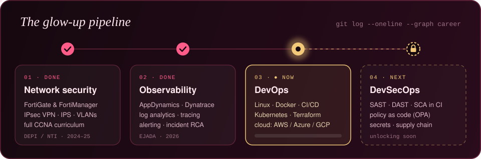
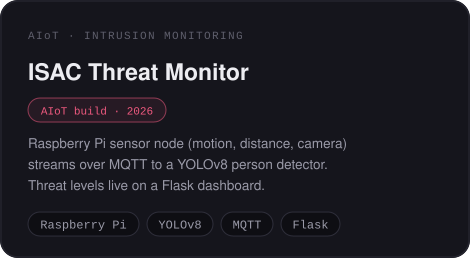
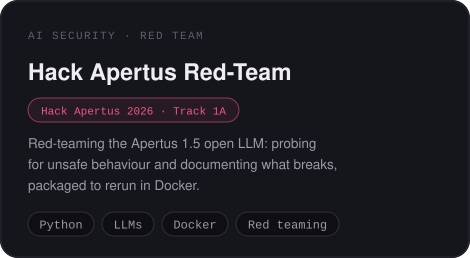

<p align="center">
  
</p>

<p align="center">
  <a href="https://www.linkedin.com/in/nourseen-tarek-1a9718399"></a>
  <a href="mailto:nourkhfaga@gmail.com"></a>
</p>

<br>

## 💅 `whoami`


## 🚀 The glow-up

Networks first, then watching systems in production, now building the pipelines, and next, securing every step of them.



<p align="center">
  <br>
  <sub><i>me, when someone asks if I'm learning DevSecOps on top of DevOps</i></sub>
</p>

## 🧰 Toolbox

<p align="center"><b>☁️ ship it</b></p>
<p align="center">
  
</p>

<p align="center"><b>🛒 in my cart</b> <sub>(learning right now)</sub></p>
<p align="center">
  
</p>

<p align="center"><b>🔐 secure it</b> &nbsp;·&nbsp; <b>📈 watch it</b></p>
<p align="center">
  
  
  
  
  
  <br>
  
  
  
  
</p>

<p align="center"><b>💻 build it</b></p>
<p align="center">
  
</p>

## 🏆 Featured builds

<table>
  <tr>
    <td width="50%"><a href="https://github.com/nourseen6/incident-commander"></a></td>
    <td width="50%"><a href="https://github.com/nourseen6/sentrix-core"></a></td>
  </tr>
  <tr>
    <td width="50%"><a href="https://github.com/nourseen6/isac-smart-threat-monitor"></a></td>
    <td width="50%"><a href="https://github.com/nourseen6/hack-apertus-redteam"></a></td>
  </tr>
</table>

<p align="center">
  <sub>also on the runway:
  <a href="https://github.com/nourseen6/Fortinet-Device-Management-with-FortiManager">FortiManager fleet lab</a> ·
  <a href="https://github.com/nourseen6/PetroTrans-Lubricants-System">PetroTrans desktop system</a> ·
  <a href="https://github.com/nourseen6/garage-pay">Garage Pay</a></sub>
</p>

## 🌸 `diva.yaml`

```yaml
apiVersion: diva.dev/v1
kind: Engineer
metadata:
  name: nourseen-tarek
  labels:
    vibe: main-character
    tier: production-ready
spec:
  replicas: 1                          # one of a kind 💅
  image: nourseen:latest-and-greatest
  strategy: shift-left                 # security first, heels on
  nodeSelector:
    community: women-in-tech
  securityContext:
    runAsNonRoot: true
    readOnlyRootFilesystem: true       # can't change my mind either
  resources:
    requests: { coffee: "3 cups", playlist: "loud" }
    limits:   { tolerance_for_hardcoded_secrets: "0" }
  livenessProbe:
    exec: ["kubectl", "get", "vibes"]
```

## 📬 Let's build something secure together

<p align="center">
  Always up for DevOps and DevSecOps chats, hackathon teams, and long talks about pipelines.<br><br>
  <a href="https://www.linkedin.com/in/nourseen-tarek-1a9718399"></a>
  <a href="mailto:nourkhfaga@gmail.com"></a>
</p>


