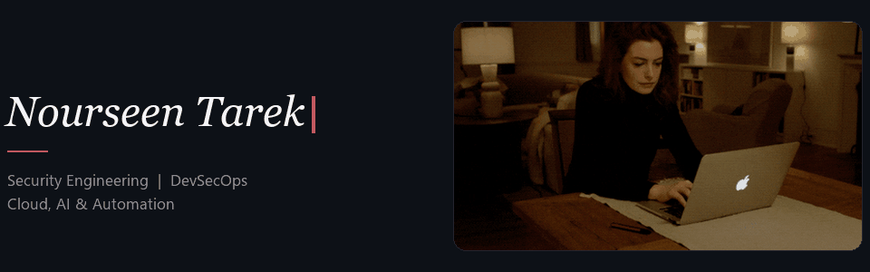
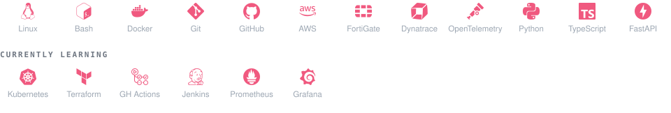

### Currently working on

| Project | What it is | Stack |
| --- | --- | --- |
| [**Incident Commander**](https://github.com/nourseen6/incident-commander) | Multi-agent incident diagnosis with policy-as-code guardrails. 1st place, DevOpsDays Cairo 2026 | Python · FastAPI · React · TypeScript |
| [**SentriX Core**](https://github.com/nourseen6/sentrix-core) | Graduation project: personal-safety wearable with on-device AI and secure alerts | TinyML · BLE · eSIM · Cloud |
| [**Secure CI/CD Pipeline**](https://github.com/nourseen6/secure-cicd-pipeline) | DevSecOps pipeline with secret, image and dependency scanning that fails on CRITICAL | GitHub Actions · Jenkins · Docker · Trivy |

<b>Check out my other projects</b>

  
  
  
  
  
  

### Technologies

<h3 align="center">Let's build something together</h3>

  Up for contributing to open source, joining a hackathon team, or building something new together.

  
  

 

