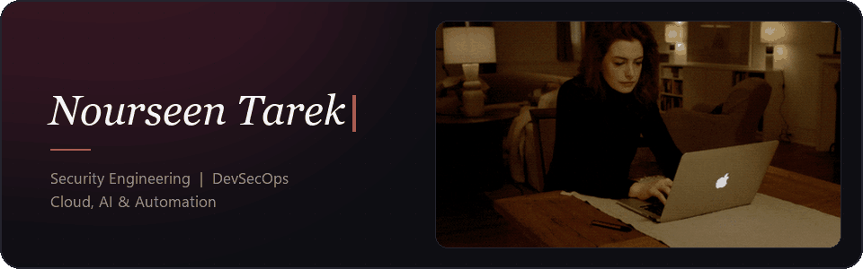
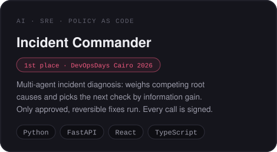
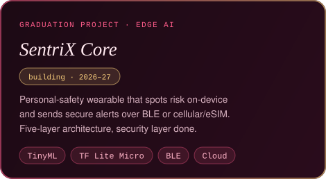

### Currently working on

<table>
  <tr>
    <td width="50%"></td>
    <td width="50%"></td>
  </tr>
</table>

<b>Check out my other projects</b>

  
  
  
  
  
  

### Toolbox

<table>
  <tr><td><b>Cloud &amp; DevOps</b></td><td>        </td></tr>
  <tr><td><b>Learning now</b></td><td>      </td></tr>
  <tr><td><b>Security</b></td><td>      </td></tr>
  <tr><td><b>Observability</b></td><td>     </td></tr>
  <tr><td><b>Languages</b></td><td>       </td></tr>
  <tr><td><b>Frameworks</b></td><td>      </td></tr>
  <tr><td><b>AI &amp; IoT</b></td><td>      </td></tr>
</table>

<h3 align="center">Let's build something together</h3>

  Up for contributing to open source, joining a hackathon team, or building something new together.

  
  
  

 

